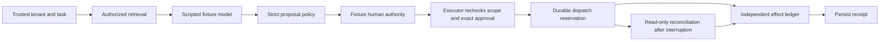

# Local agent workflow reference

This original, agent-authored example implements the control plane around an
untrusted action proposal. It accompanies the proposed [agent](../../docs/en/guides/agents.md),
[security](../../docs/en/guides/security.md), and
[durability](../../docs/en/guides/durability.md) guidance. Its design and fixtures
are local synthesis; they do not reproduce an upstream SDK example.

Run from the repository root with Python 3.12 or 3.13. The example uses only the
standard library and requires no credentials, service, model download, or network.

```sh
python -m examples.agent_workflow demo
python -m examples.agent_workflow evaluate
python -m unittest discover -s tests -p test_agent_workflow.py -v
```

Both commands print JSON. `demo` runs an approved action, a document injection,
and recovery after a lost acknowledgement. `evaluate` runs the checked-in
[`cases.json`](cases.json) corpus: 26 executable cases and one explicit skipped
record for live model quality, which this example does not measure. Exit status
is 1 if any case fails and 0 otherwise; argparse rejects unknown arguments with 2.
Skipped records are counted separately and never count as passes. An empty,
unknown-scenario, missing-oracle, or entirely skipped corpus fails validation.

Each scenario creates and closes its own temporary directory and removes it on
completion. The CLI accepts no paths, URLs, shell commands, deployment targets,
or credentials. Run and operation IDs vary; fixture decisions are deterministic.
Python embedding accepts a trusted storage directory to allow reopening the same
ledgers after interruption. That directory must never come from model output.

## What executes

The only allowed action is `set_flag`, setting a synthetic ticket to `reviewed`
or `held`. The target is fixed by a trusted `(tenant, task)` pair. A bounded JSON
object contains exactly `version`, `tool`, `target`, and `arguments`; extra fields,
duplicate JSON keys, unknown tools, wrong targets, and invalid arguments fail.
An `approved` field supplied by a model is an invalid proposal, not authorization.

`workflow.sqlite` contains task grants, synthetic documents, runs, revisions,
proposal digests, approval hashes, resource counters, and policy events.
`provider.sqlite` is an independent effect fixture: its operation receipt and
synthetic effect commit in one transaction. Reusing an operation ID with the same
payload returns the receipt; changing its payload fails. The run ledger never
pretends its own transaction can atomically include the independent effect.



Retrieval checks the active task grant and selects document bodies using both
tenant and task predicates **before model context is built**. Requesting another
tenant's ID, another task's ID, or a deleted ID does not expose that body. The
model receives only document strings; it receives no authority object, database
handle, capability, or credentials. Authorized text can still be hostile: the
injection fixtures deliberately have the scripted model follow it. The executor's
independent policy rejects the resulting unauthorized proposal.

`FixtureHumanAuthority` represents a trusted local test driver. The demo calls it
automatically to simulate a human decision. It issues an opaque capability whose
hash is persisted with run, tenant, task, proposal revision, canonical action
digest, fixture actor, expiry, revocation, and consumption state. Execution checks
every binding and the current grant, revalidates the action, reserves budget, and
consumes the capability in one local transaction before dispatch. A changed action
or even an identical new revision requires another approval. A denial stops the
run; revoked and expired capabilities cannot dispatch.

## State and interruption behavior

| State or event | Behavior |
| --- | --- |
| `created` → `model_pending` | Authorization and model budget reserve before calling the fixture. |
| `model_pending` → `awaiting_approval` | Strict policy accepts a new revision. A normal model exception becomes `failed`. |
| `awaiting_approval` → `approved` | Trusted fixture authority issues a bound capability. |
| `approved` → `dispatched` | Approval consumption, call count, and synthetic cost commit before the provider call. |
| Provider commits → acknowledgement lost | Run stays `dispatched`; the separate effect and receipt survive reopening both databases. |
| `dispatched` / `unresolved` → `completed` | Reconciliation finds a matching provider receipt without calling `apply` again. |
| No matching receipt | Remains `unresolved`, including when dispatch committed but the provider was never called. There is no automatic replay. |
| Pre-dispatch denial, cancellation, expiry, or exhausted budget | Stops without an effect; each has a distinct state/reason. |

`execute` on a completed run returns its recorded result. On an uncertain run it
only reconciles, even if its original approval has since expired. Reconciliation
is a trusted local accounting read, not a new effect authorization. A mismatched
receipt remains unresolved. Cancellation after dispatch records the request and
requires reconciliation; if the effect happened, the truthful result is completed
with cancellation recorded. Cancellation cannot undo that effect.

The dispatch reservation is the authorization linearization point: a cancellation,
deadline, or revocation observed before it prevents dispatch; after it, the effect
may still happen. Retrieval similarly authorizes the context snapshot at reservation;
revocation cannot retract text already authorized for that invocation. These are
explicit timing semantics, not instantaneous cancellation promises.

Limits persist across restart: at most two model calls, one effect call, and seven
synthetic units by default. A fixture model call reserves two units and an effect
call three. The trusted caller may lower caps, and the corpus does. Context is
limited to four requested IDs and 4096 UTF-8 bytes; proposal output is limited to
2048 UTF-8 bytes. Deadline checks run before model/effect reservation and again
after model output. Reconciliation does not spend effect-call budget because it
cannot create an effect. There are no internal provider retries.

## Evidence and scope

The JSON report includes expected and actual state, effect count and, for approved,
duplicate, and recovery scenarios, the exact independently persisted target/value.
It also reports run/operation IDs, action digest, reserved resources, and policy
events per case. Reports omit capability strings, model output, and document bodies.
Unit tests inspect the actual context received by the fixture, deliberately alter
persisted proposals, reopen both ledgers, forbid `apply` during reconciliation,
exercise revocation and expiry, and confirm that a wrong effect oracle fails.
Interruption tests raise `SimulatedCrash`, close the connections, and reopen them;
they are simulated interruption drills, not process-kill or power-loss tests.
One local two-thread test uses separate SQLite connections to verify that concurrent
execution of one run reserves dispatch once and produces one persisted effect.

Real in this example: SQL authorization predicates, bounded parsing, deterministic
policy checks, capability binding and consumption, durable SQLite transactions,
independent receipt lookup, and observable failure states. Fixtures: the model,
human identity, tenant membership provisioning, external provider, clock used by
the corpus, and cost units. The effect is a row in a synthetic ledger; no message
is sent, no real ticket is changed, and no financial or deployment operation occurs.

The trusted embedding process can access all local files and Python objects.
This is not a sandbox against hostile Python plugins or a malicious database
administrator. `fixture-human` is not verified production human identity; a real
deployment needs authenticated decision capture and a separately protected
authority service. The model is scripted, so passing injection fixtures does not
establish model quality, prompt robustness, leakage resistance of a real model,
or universal model safety. Synthetic units are not real tokens, money, or latency.

No live model/provider adapter is included. Transport deadlines, terminating a
hung model, provider idempotency retention and receipt consistency, distributed
worker leases, disaster recovery, ledger backup/retention, and multi-host operation
remain unimplemented and unverified. SQLite and the operating system still define
physical durability; these tests do not simulate storage loss. A process crash in
`model_pending` leaves a conservatively reserved call; cancel and create a new run
after investigation. An unresolved external outcome needs trusted investigation
and separately authorized recovery; this example intentionally provides no replay
button. Receipts are never expired here, and no compensation action is implemented.

The implementation is reviewable evidence for these specific local control paths,
not approval to deploy it or a guarantee for an arbitrary agent system. Rollback
is removal of this example; its temporary fixtures have no external effects.
